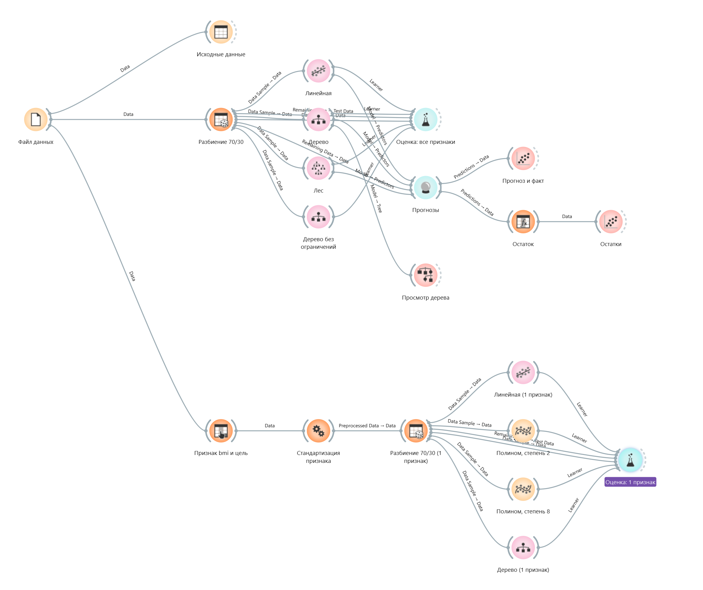

::: toc
:::

# Цель работы

Изучить построение моделей регрессии и сравнить их по метрикам MSE, MAE и $R^2$ на тестовой выборке.

# Ход работы

Качество моделей оценивается по формулам [](#eq:mse) и [](#eq:r2); схема эксперимента показана на [](#fig:flow).

## Метрики качества

$$ \mathrm{MSE}=\frac{1}{n}\sum_{i=1}^{n}\left(y_i-\hat y_i\right)^2 $$ {#eq:mse}

::: where
$y_i$
:   фактическое значение

$\hat y_i$
:   прогноз модели

$n$
:   размер выборки
:::

$$ R^2=1-\frac{\sum_i (y_i-\hat y_i)^2}{\sum_i (y_i-\bar y)^2} $$ {#eq:r2}

::: where
$\bar y$
:   среднее фактических значений
:::

## Порядок выполнения

1) загрузить набор данных (файл *Housing*);
2) разделить его на обучающую и тестовую выборки;
3) обучить модели:
   - линейную регрессию;
   - дерево решений;
   - случайный лес;
4) сравнить метрики качества.

Результаты сведены в таблицу [](#tbl:res).

::: {.table #tbl:res}
Сравнение моделей по метрикам качества

| Модель | MSE | MAE | $R^2$ |
|:-------|----:|----:|------:|
| Линейная регрессия | 24,3 | 3,4 | 0,72 |
| Дерево решений | 21,7 | 3,1 | 0,75 |
| Случайный лес | **10,8** | **2,2** | **0,87** |
:::

{#fig:flow width=14cm}

## Код

Расчет метрик показан в листинге [](#lst:evaluate).

``` {#lst:evaluate .python .numberLines caption="Оценка моделей" highlight=true file=../listings/evaluate_models.py}
```

# Вывод

Лучшей по метрикам оказалась модель случайного леса: у нее наименьшая ошибка (см. [](#eq:mse)) и наибольший $R^2$.
